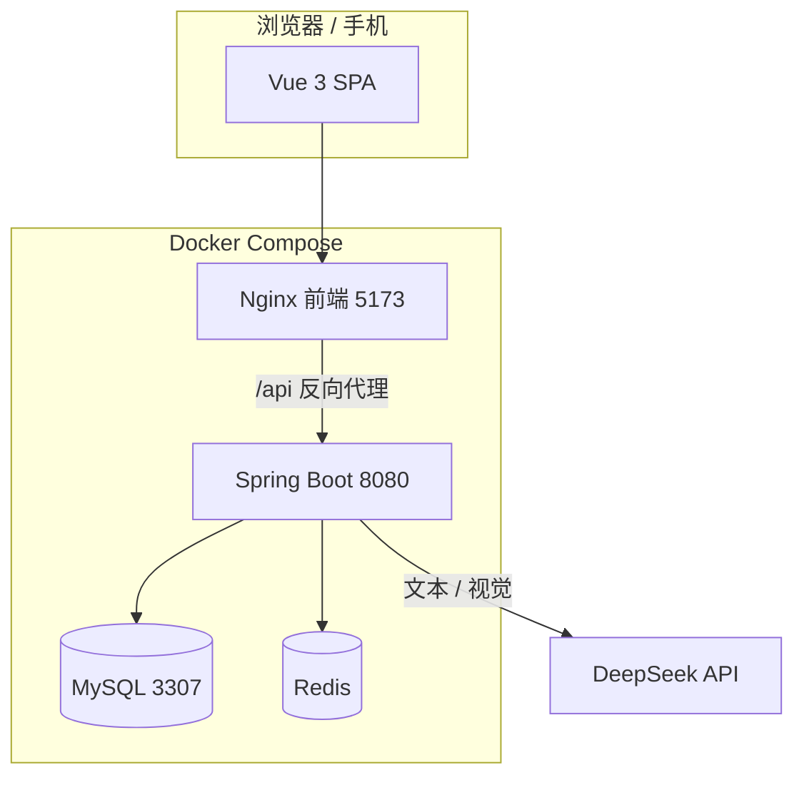
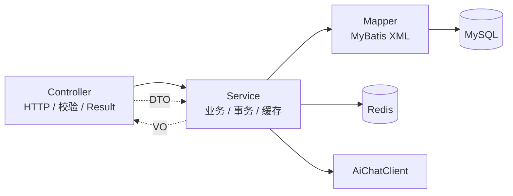
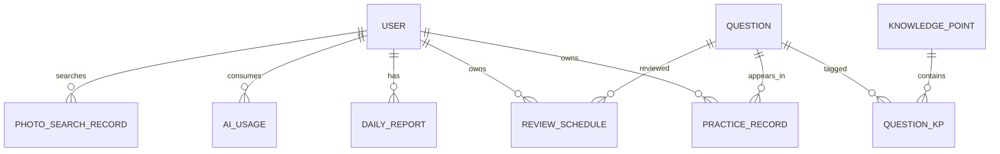
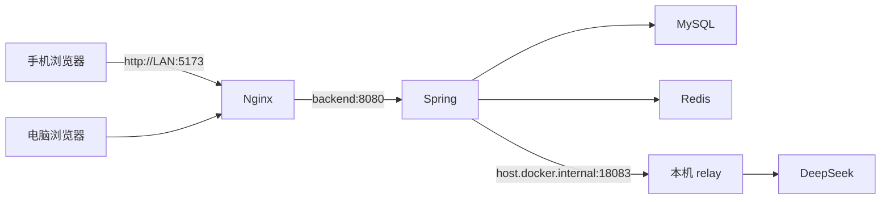

# 架构概览

## 1. 组件图



## 2. 后端分层



规则：

- Controller 不写 SQL、不写业务分支
- Service 不拼 HTTP，AI 请求统一走 `AiChatClient`
- Mapper 只做数据访问
- Entity 只映射表，不直接返回给前端

## 3. 数据模型（核心表）



关键字段：

- `user.role`：USER / ADMIN
- `user.token_version`：改密/登出/刷新时递增，撤销旧 JWT
- `practice_record.is_correct`：NULL 表示大题未自评
- `daily_report`：历史快照，含 submitted/graded/overall_mastery
- `ai_usage`：按 user+date 唯一，配额原子扣减
- `photo_search_record`：只存识别文本，不存原图

## 4. 部署



说明：

- 前端是静态文件 + Nginx
- 后端只绑定 `127.0.0.1:8080`，公网只走 Nginx
- 本机 relay 只是当前 Docker 出站 TLS 的临时绕行；生产服务器直接用 `https://api.deepseek.com`

## 5. 关键设计取舍

| 问题 | 选择 | 原因 |
|---|---|---|
| 认证 | JWT + refresh 轮换 | 无状态、可水平扩展；refresh 降低 access 泄露窗口 |
| 撤销 | `token_version` | 不引入黑名单表，改密/登出立即失效 |
| 限流 | Redis 计数 + 本地降级 | 多实例共享；Redis 挂时不阻塞登录 |
| 报告 | 今天实时 / 历史快照 | 当天新题能立刻反映；历史不随之后数据变化 |
| 缓存 | Cache-Aside | 提交后删缓存，逻辑简单、避免双写不一致 |
| AI 讲解 | SSE | 单向流式，HTTP 原生，断线重连简单 |
| 拍照 | 图片不落盘 | 隐私风险低；只保存识别文本 |
| 配额 | 先扣 + 失败退款 | 防并发超卖；失败不坑用户 |
| 错题 | 只答错入队 | 复习队列聚焦薄弱题，不把所有题都塞进去 |

## 6. 一次请求的横切关注点

```text
请求
 → CORS
 → JwtAuthenticationFilter（认证）
 → Controller（参数校验）
 → Service（事务/业务/缓存）
 → Mapper（SQL）
 → Result 包装
 → 全局异常处理
```

异步/流式请求额外注意：

- `SseEmitter` 完成会触发 ASYNC dispatch
- `SecurityConfig` 要放行 `DispatcherType.ASYNC/ERROR`
- 用户 id 在请求线程取出后传进线程池，不能依赖 SecurityContext 跨线程
