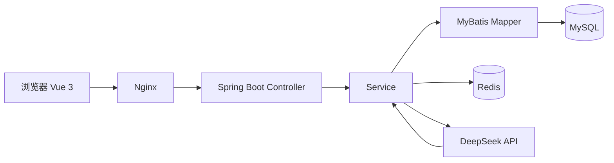
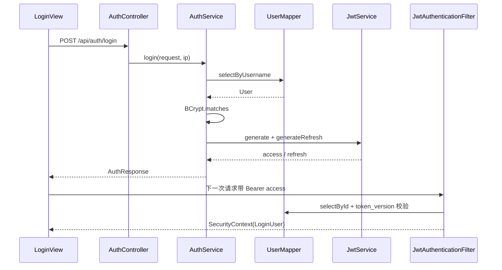
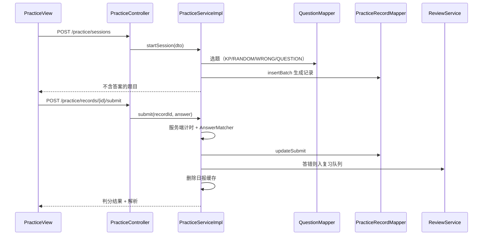
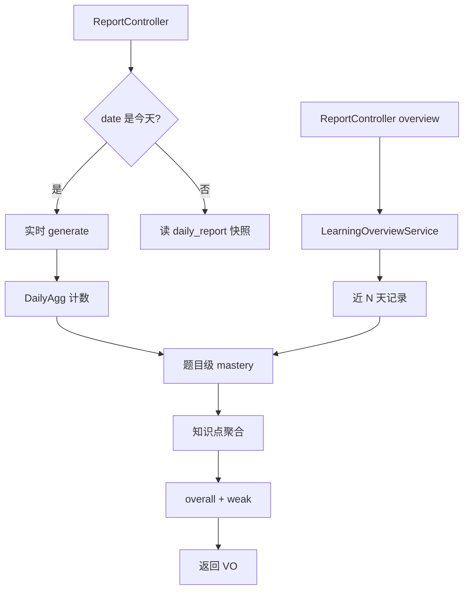
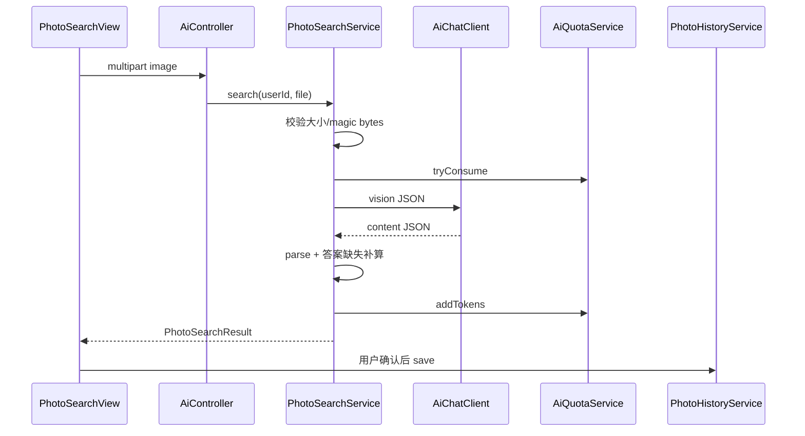

# Code Tour：四条主链路

> 用法：开着应用读，不要只看代码。每条链路先看入口，再看出口，中间文件按顺序读。
> 配套：`docs/ARCHITECTURE.md`、`docs/LEARNING_GUIDE.md`。

## 0. 先建立一张地图



分层规则：

- Controller 只做参数接收和 Result 包装
- Service 放业务规则、事务、缓存
- Mapper 只写 SQL
- Entity 对应表，VO 对应接口返回，DTO 对应接口入参

不要在 Controller 里写 SQL，也不要在 Mapper 里写业务判断。

## 1. 登录与 JWT

### 入口

- 前端：`frontend/src/views/LoginView.vue` 的 `submit()`
- 接口：`POST /api/auth/login`
- 后端：`auth/controller/AuthController.java`

### 调用链



### 必读文件

| 文件 | 一句话职责 |
|---|---|
| `LoginView.vue` | 收集用户名密码，调 `api.login()`，保存登录态 |
| `api/index.js` | axios 实例、401 刷新、接口封装 |
| `auth.js` | localStorage token、refresh、user、多标签同步 |
| `AuthController` | 登录/注册/刷新/登出/改密入口 |
| `AuthService` | 认证用例：BCrypt、JWT、token_version |
| `JwtService` | 生成/解析 access 与 refresh |
| `JwtAuthenticationFilter` | 每个请求解析 token 并放当前用户 |
| `CurrentUser` | 从 SecurityContext 取 userId |
| `SecurityConfig` | 哪些接口公开、哪些要 ADMIN |

### 三个自测问题

1. 密码在数据库里存的是什么？登录时怎么比对？
2. access token 和 refresh token 的职责分别是什么？
3. 为什么 `token_version` 能撤销旧 token？

### 小练习

登录页加“显示/隐藏密码”。只改前端，不改后端。

## 2. 练习与判分

### 入口

- 前端：`PracticeView.vue`，先看 `phase = setup | practicing | result`
- 接口：`POST /api/practice/sessions`、`POST /api/practice/records/{id}/submit`

### 调用链



### 必读文件

| 文件 | 一句话职责 |
|---|---|
| `PracticeView.vue` | 选题、答题、AI 讲解、结果页 |
| `PracticeController` | 开始/提交/自评/按日查询 |
| `PracticeServiceImpl` | 选题、计时、判分、错题入队 |
| `AnswerMatcher` | 分数/小数/LaTeX 等价比较 |
| `PracticeRecordMapper` | 练习记录 SQL |
| `ReviewService` | 答错后推进艾宾浩斯队列 |

### 三个自测问题

1. 为什么计时在服务端做，而不是前端传？
2. 提交答案后，后端按顺序做了哪几件事？
3. 为什么提交后要删日报缓存，而不是更新缓存？

### 小练习

题库加“难度筛选”。要同时改前端筛选和 SQL 条件。

## 3. 日报与整体分析

### 入口

- 日报：`GET /api/reports/daily?date=...`
- 整体：`GET /api/reports/overview?days=30`
- 前端：`ReportView.vue`、`ReportOverviewView.vue`

### 调用链



### 必读文件

| 文件 | 一句话职责 |
|---|---|
| `ReportController` | 日报/区间/整体入口 |
| `ReportServiceImpl` | 今天实时、历史快照、日报聚合 |
| `LearningOverviewService` | 近 7/30/90 天整体分析 |
| `MasteryCalculator` | 题目级纯公式 |
| `MasteryAggregator` | 最近 5 次、streak、整体加权 |
| `DailyReportMapper` | 快照读写 |

### 三个自测问题

1. 日报的“开始/提交/有效判分”分别是什么？
2. 为什么正确率分母不用 `totalCount`？
3. 日报和整体分析为什么不能共用一个“掌握度”？

### 小练习

日报加“今日总用时”。要改 VO、Service、前端。

## 4. AI 讲解与拍照搜题

### 入口

- 讲解：`POST /api/ai/explain/{recordId}`，SSE
- 拍照：`POST /api/ai/photo-search`，multipart
- 前端：`PracticeView.explainWithAi`、`PhotoSearchView.search`

### 拍照链路



### 必读文件

| 文件 | 一句话职责 |
|---|---|
| `AiController` | 讲解/配额/拍照/历史入口 |
| `AiExplanationService` | 查缓存、降级、SSE、落库 |
| `PhotoSearchService` | 图片校验、vision、解析、补答案 |
| `AiChatClient` | OpenAI 兼容 URL/Bearer/JSON |
| `AiQuotaService` | 每日配额、token 估算、退款 |
| `PhotoHistoryService` | 只存识别文本，不存原图 |
| `PhotoSearchView.vue` | 拍照/压缩/结果/保存 |

### 三个自测问题

1. 为什么图片不落盘？原图存在哪里？
2. 为什么缓存/无 key 不扣配额，而模型失败要退款？
3. 为什么拍照结果要用户确认后才保存？

### 小练习

给 AI 讲解加“停止生成”。用 `AbortController`。

## 5. 前端结构

```text
App.vue                 布局/导航/登录态
router/index.js         路由和守卫
auth.js                 token/refresh/多标签
api/index.js            axios + 接口
api/normalize.js        后端字段 → 页面字段
views/*.vue             页面
utils/math.js           KaTeX + DOMPurify
mock/                   本地模拟（?mock=1）
```

读页面时先找三个东西：

1. `onMounted` 拉什么数据
2. 用户点击调哪个 `api.*`
3. 成功后改哪个 `ref`

## 6. 暂时不要读

- `V2SchemaMigration`：历史迁移，和主流程无关
- `mock/`：本地模拟，不是真实链路
- `Admin*`：管理端，先跳过
- `SkeletonSmokeTest`：通用层测试

## 7. 7 天阅读清单

| 天 | 读 | 动手 |
|---|---|---|
| 1 | LoginView、AuthController、AuthService | 跑起来，看 Network |
| 2 | JwtService、JwtFilter、CurrentUser | 画登录时序图 |
| 3 | QuestionBank、QuestionService、Mapper XML | 题库筛选 |
| 4 | PracticeView、PracticeService、AnswerMatcher | 提交一道题 |
| 5 | ReportController、ReportService、Mastery | 看日报字段 |
| 6 | PhotoSearchView、PhotoSearchService、AiChatClient | 拍一道题 |
| 7 | Docker/Nginx/README | 画整体架构图 |

每天结束写 3 行：

- 今天看懂了什么
- 还没懂什么
- 明天先看哪个文件
